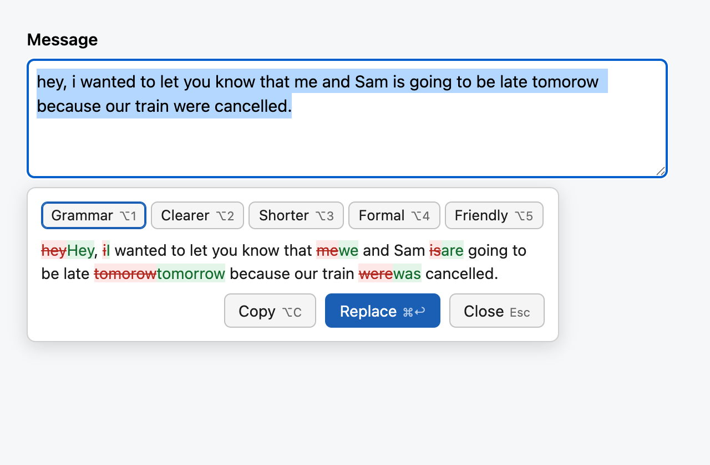
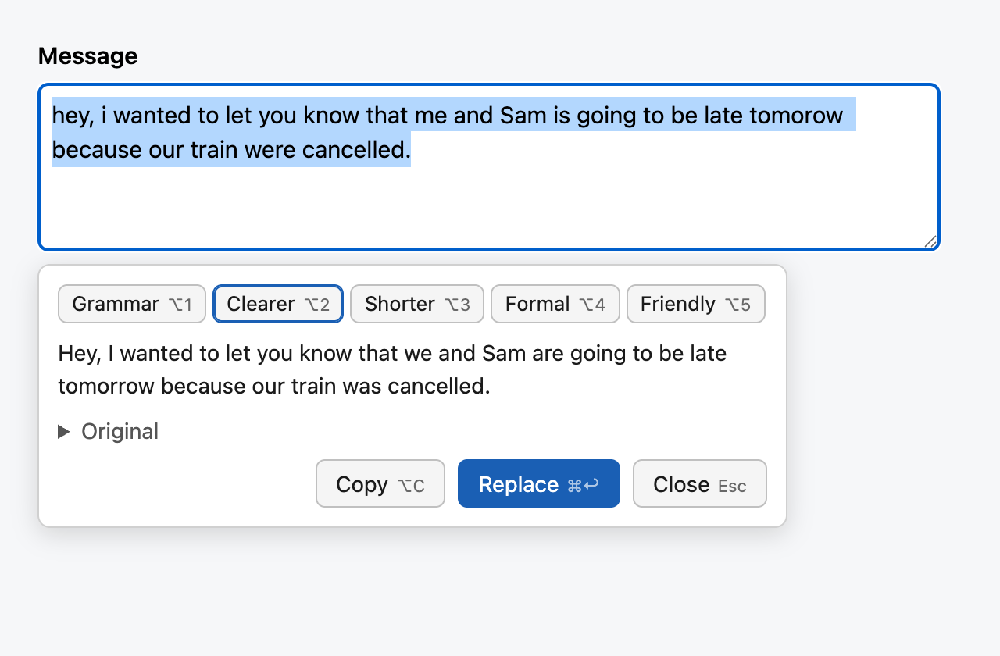
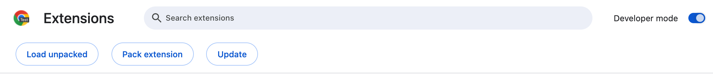
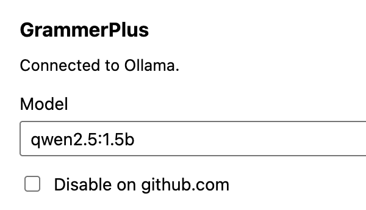

# GrammerPlus

GrammerPlus is a Chrome extension that fixes grammar and rewrites text in any web text field, using a small language model running on your own computer through [Ollama](https://ollama.com). Your text is sent only to Ollama on `localhost`; it never leaves your machine.

Select some text, press **Alt+Shift+G**, and a card shows the suggested fixes. Press **Replace** to apply them, or **Cmd+Z** (Ctrl+Z on Windows and Linux) to undo.



The buttons at the top of the card rewrite the selection instead: **Clearer**, **Shorter**, **Formal** or **Friendly**.



Small models make mistakes. In the example above the rewrite says "we and Sam", which is still wrong. Read every suggestion before you press Replace, especially rewrites, which sometimes add or drop details.

## Requirements

- Google Chrome, or another Chromium browser that can load unpacked extensions. Tested on Chrome on macOS with an Apple M2. Brave, Edge, Windows and Linux are untested.
- [Ollama](https://ollama.com/download), installed and running.
- About 1 GB of free disk space and memory for the default model.

## Install

### 1. Install Ollama and a model

Download Ollama from [ollama.com/download](https://ollama.com/download) and start it. Then pull the default model in a terminal:

```sh
ollama pull qwen2.5:1.5b
```

Check that it works:

```sh
ollama run qwen2.5:1.5b "Fix the grammar: she go home."
```

You don't need to set `OLLAMA_ORIGINS`. The extension removes the browser's `Origin` header from its own requests to `localhost`, so Ollama accepts them without any setup.

### 2. Get the code

```sh
git clone https://github.com/[TODO: user/repo].git
cd grammerPlus
```

Or download the ZIP from GitHub and unzip it.

### 3. Load the extension in Chrome

1. Open `chrome://extensions`.
2. Turn on **Developer mode** (top right).
3. Click **Load unpacked** and choose the `extension` folder inside the project. Choose the `extension` folder itself, not the project root.



GrammerPlus now appears in the list. Pin it from the puzzle-piece menu in the toolbar if you want quick access to its settings.

### 4. Check the connection

Click the GrammerPlus icon in the toolbar. The popup should say **Connected to Ollama**.



From the popup you can also:

- **Pick a model.** The list shows every model you have pulled in Ollama.
- **Turn GrammerPlus off for the current site.**

## Use

1. Select text in a text box, a single-line input, or a rich-text editor (for example Gmail compose or a GitHub comment).
2. Press **Alt+Shift+G**, or right-click and choose **Check grammar**.
3. Review the card:
   - **Grammar** (the default) shows deletions in red and insertions in green.
   - **Clearer**, **Shorter**, **Formal** and **Friendly** show the rewritten text. Click **Original** to see what you selected.
4. Press **Replace** to apply the suggestion, or **Close** (or Esc) to leave the text as it is. One Cmd+Z undoes a replacement.

Everything on the card has a keyboard shortcut, and your cursor stays in the text field while you use them:

| Action | Mac | Windows and Linux |
|---|---|---|
| Grammar, Clearer, Shorter, Formal, Friendly | Option+1 to Option+5 | Alt+1 to Alt+5 |
| Replace | Cmd+Enter | Ctrl+Enter |
| Copy | Option+C | Alt+C |
| Close | Esc | Esc |

Each button shows its shortcut in small grey text, and the toolbar popup lists them too. While the card has no suggestion to apply (for example while it is still checking), Cmd+Enter goes to the page as usual, so a site's own "send" shortcut still works.

If you edit the text while the card is open, Replace refuses to apply the old suggestion. Press **Copy** to put the suggestion on the clipboard and paste it yourself, or select the text and check again. Copy also works on text you can't edit, such as a web page's own text.

Rewrites accept up to 3,000 characters at a time. Grammar checks have no limit; the text is split into sentences and each sentence is checked separately.

To change the shortcut, open `chrome://extensions/shortcuts`. If another extension already uses Alt+Shift+G, Chrome leaves GrammerPlus without a shortcut, and the popup says so.

## Choosing a model

The default is `qwen2.5:1.5b`. In a partial benchmark on 100 sentences from the [JFLEG](https://github.com/keisks/jfleg) test set on an M2:

| Model | Correction quality (F0.5, higher is better) | Median time per sentence |
|---|---|---|
| `qwen2.5:3b` | 0.54 | 314 ms |
| `qwen2.5:1.5b` | 0.49 | 183 ms |

`qwen2.5:3b` is more accurate and about 70% slower. To use it, run `ollama pull qwen2.5:3b` and pick it in the popup. Other models have not been fully benchmarked yet.

## Troubleshooting

| What you see | What to do |
|---|---|
| "Ollama is not running" | Start the Ollama app, or run `ollama serve` in a terminal. |
| "Model … is not installed" | Run `ollama pull <model>`, or pick an installed model in the popup. |
| "Ollama blocked the extension" | The header rule did not apply. Run `launchctl setenv OLLAMA_ORIGINS "chrome-extension://*"` (macOS) and restart Ollama, or start it with `OLLAMA_ORIGINS="chrome-extension://*" ollama serve`. |
| The shortcut does nothing | Check `chrome://extensions/shortcuts`, check that the site isn't turned off in the popup, and make sure text is selected inside an editable field. |
| The first check is slow | Ollama loads the model into memory on first use. It stays loaded for 30 minutes after the last request. |

## What it doesn't do

- No underlines as you type yet. Checks run only when you ask.
- Google Docs isn't supported (it draws text on a canvas, not in a text field).
- Password fields are never read.
- English only.

## Privacy and permissions

| Permission | Why |
|---|---|
| Access to all sites (content script) | To read the selected text when you press the shortcut and to show the card. Nothing is read until you ask. |
| `localhost` / `127.0.0.1` | To talk to Ollama. |
| `declarativeNetRequest` | To strip the `Origin` header from the extension's own requests to Ollama. Requests from web pages are not changed, so websites still can't reach your Ollama. |
| `storage` | To save the model choice and the sites you turned off (synced through your Chrome profile). |
| `contextMenus`, `activeTab`, `scripting` | For the right-click item, and to start the extension in tabs that were open before it was installed. |

The extension makes no other network requests.

## Development

No build step and no runtime dependencies: the `extension/` folder is loaded as is. After editing, click the reload icon on the GrammerPlus card in `chrome://extensions` and refresh the page you're testing on.

Run the unit tests (Node.js 18 or later):

```sh
npm test
```

Run the model benchmark:

1. Download the JFLEG test set (`test.src` and `test.ref0` to `test.ref3`) from the `test/` folder of [keisks/jfleg](https://github.com/keisks/jfleg) into `data/jfleg/`. JFLEG is licensed CC BY-NC-SA, so it isn't included here.
2. Pull the models listed in `bench/config.json`.
3. Run `npm run bench`. Results go to `runs/<timestamp>/`.

Project layout:

```
extension/            the extension (load this folder in Chrome)
  manifest.json
  background.js       service worker: shortcut, menu, calls to Ollama, cache
  content.js          reads the selection, draws the card, applies Replace
  popup.html/.js      settings popup
  lib/                shared code: Ollama client, word diff, sentence splitter, settings
test/                 unit tests (node --test)
bench/                model benchmark on JFLEG
```

## License

MIT. See [LICENSE](LICENSE).
